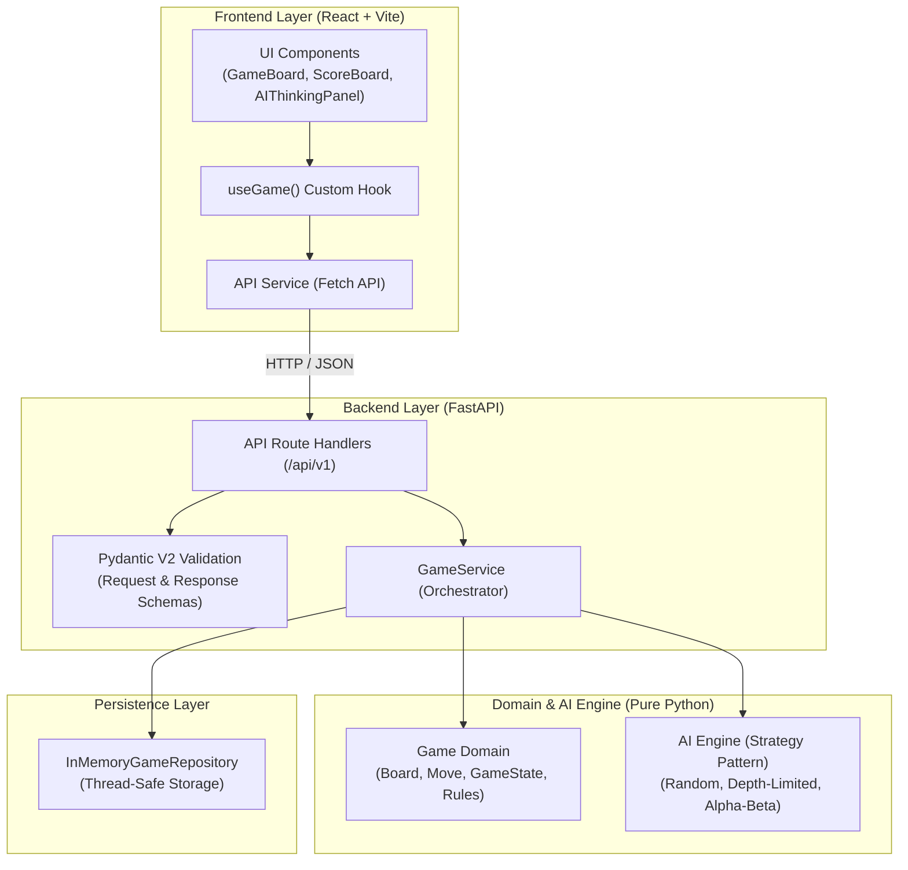
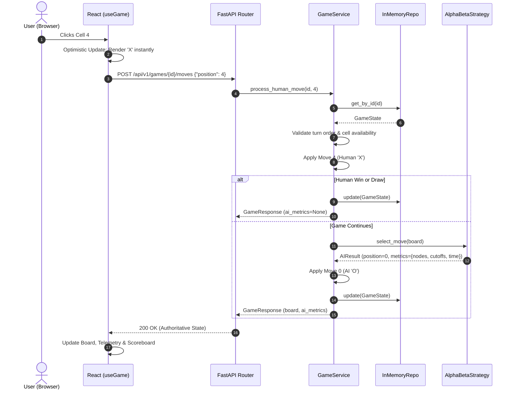

# System Architecture & Technical Design

This document details the software architecture, design patterns, and engineering decisions implemented in the Full-Stack AI Tic-Tac-Toe application.

---

## 1. High-Level Architecture Overview

The system adopts a **Layered Monolithic Architecture** with strict dependency boundaries. The domain models and AI search algorithms operate as pure, decoupled engines with zero dependencies on web frameworks or storage systems.

---

## 2. Component Responsibilities

| Layer / Component | Primary Responsibility | Key Files |
| :--- | :--- | :--- |
| **Frontend Presentation** | Renders UI, provides visual feedback, manages responsive styling. | `App.jsx`, `GameBoard.jsx`, `ScoreBoard.jsx`, `AIThinkingPanel.jsx` |
| **Frontend State & API** | Orchestrates optimistic UI updates, handles session scoreboard, communicates via `fetch`. | `useGame.js`, `api.js` |
| **API Layer** | Request routing, CORS configuration, schema validation, HTTP status code translation. | `main.py`, `games.py`, `schemas/game.py` |
| **Game Service** | Coordinates human move execution, terminal checks, AI move calculation, and persistence. | `services/game_service.py` |
| **Game Domain** | Enforces game invariants, board representation, win/draw detection, turn switching. | `domain/models.py`, `domain/exceptions.py` |
| **AI Engine** | Game tree traversal, heuristic scoring, $\alpha$-$\beta$ branch pruning, search telemetry. | `algorithms/minimax.py`, `algorithms/alpha_beta.py`, `algorithms/factory.py` |
| **Repository** | Thread-safe in-memory session management. Decoupled via Abstract Base Class (`GameRepository`). | `repositories/base.py`, `repositories/memory.py` |

---

## 3. Data Flow: Processing a Human Move

When the human clicks cell 4 on the grid:

---

## 4. Key Architectural Patterns

1. **Authoritative Server**: The client never determines win status or modifies board arrays directly. The backend validates and returns authoritative state.
2. **Strategy Pattern**: All AI difficulty levels implement the common `AIStrategy` interface, allowing plug-and-play AI engines without modifying game logic.
3. **Repository Pattern with Dependency Injection**: In-memory storage is decoupled through `GameRepository(ABC)` and injected into FastAPI routes via `Depends(get_game_service)`.
4. **Optimistic UI with Rollback**: Instant responsiveness on user click with rollback safety if the backend request fails.
